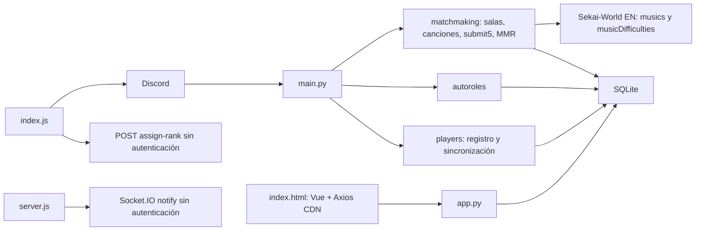

# Auditoría previa — PJSK LOUNGE

Fecha de revisión: 2026-10-31. Repositorio base: `090e97f`. No se ha encontrado otro repositorio web vinculado en este checkout. No se infieren reglas de versiones que no están disponibles.

## Inventario y dependencias originales

Python instalado 3.13.3; discord.py 2.5.2. Entry point productivo según Procfile: `main.py`. `app.py` es FastAPI pero faltan FastAPI/uvicorn en requirements. Node 22.16; index.js usa ESM sin type=module; server.js requiere socket.io ausente de package.json. No hay tests, migraciones ni CI.

Comandos activos: `/c`, `/d`, `/mmr`, `/mmr_user user`, `/top10`, `/register country`; `!submit5 block`, `!debug_diffs`, `!debug_poll`. No hay stats, set_your_country, perfiles editables, OAuth, galería de cartas ni Hall of Fame en el código recibido. Cogs inactivos conservados: mmr (implementación en memoria que colisionaría con comandos activos), placement (tres comandos de texto en memoria), ping_test (slash ping). cogs/remove_user y scripts de raíz son utilidades SQLite, algunas se ejecutan al importar.

Esquema observado, apertura SQLite solo lectura: players(user_id PK, mmr, role, name, country, season), placements(user_id PK, in_placement), songs(id,title,diff,level). Integridad SQLite: ok. 58 players, todos beta/Placement/0 MMR; 1 placement; 995 charts. mmr_data.json contiene un ID con 0; ranks.json está vacío. Existe un journal previo no versionado: no borrarlo. No hay historial de partidas, peaks ni estadísticas históricas recuperables en estas tablas. No inventarlos.

## Reglas verificadas e invariantes

- Capacidad 5; sala libre con menor distancia absoluta entre MMR del solicitante y promedio actual. Empate: primera sala en orden actual (promedio descendente tras renumerar). Sin tolerancia máxima.
- Salas `sala-N`, threads públicos, auto_archive_duration=60 minutos. Solo `/c` en canal llamado join; `/d` no exige ese canal. No hay IDs JP-PJSK/PJSK-QUEUE en los archivos recibidos; se debe aislar cada canal/guild configurado sin inventarlos.
- Puntaje submit: pesos 5,3,2,1,0. Orden estable descendente; un empate conserva el orden de las cinco líneas. No hay pairwise_deltas_simple.
- Placement original: MMR 0 + rol Placement; <=15 no-perfects da base 2000; <=50 da 1000; resto 0. Promedio de bases /5; unit=max(1,int(avg//10)); multiplicadores por posición 3,2,0.5,-1,-2; truncado int; sin floor a cero.
- Bronze si MMR<1000, Gold si <2000, Diamond en otro caso. Placement como estado inicial. Colores web #ff7000/#66311e/#ffaf00/#0080ff. IDs de roles no configurados, búsqueda por nombre.
- Canciones EN; difficulties append/master/expert; rango por rol más alto Diamond 31–33, Gold 28–30, Bronze 25–27, default 28–30. Shuffle por nivel descendente, 3 charts/nivel, hasta 9. Voto modificable, 60 segundos, ganador aleatorio uniforme entre opciones empatadas. No votos: aviso sin ganador. Catálogo cada seis horas.
- Temporada calculada en web/registro cada 3 meses desde mayo 2025, pero el código de MMR no usa season; registrar mueve jugadores entre temporadas sin archivar. Los datos reales solo indican beta. Reemplazar la inferencia de calendario por temporada explícita importada.

## Hallazgos iniciales

| Fallo | Evidencia / efecto |
|---|---|
| Submit no idempotente ni autorizado | Reenvío aplica MMR otra vez; cualquiera en thread puede enviar jugadores arbitrarios o repetidos |
| Escrituras parciales | placement se escribe antes de validar todo; REST de roles ocurre antes de commit |
| Salas en memoria y sin locks | reinicio pierde todo; usuario puede estar en varias salas; carreras al llenar o crear |
| Polls no persistidos | pérdida de votos/reinicio, sin control de participantes, valores largos inválidos |
| N+1 en join/renumeración | SELECT por miembro y sala; renombrado REST incluso sin cambios |
| Acknowledgements tardíos | DB/REST antes de responder a interacciones |
| Catálogo frágil | sin timeout/status check, DROP TABLE, doble refresh al iniciar, loop no cancelado |
| Registro deteriora persistencia | reconexión cambia season y al volver puede borrar country |
| API incompatible/insegura | expone rowid como identidad, error SQL al cliente, CORS *, asignación de roles pública |
| Lifecycle parcial | carga de cogs falla y arranque continúa; sync repetido; conexiones independientes |
| Errores ocultos | bare except/pass al archivar/renombrar/poll |
| Secretos | .env excluido del índice; no se han impreso valores. No hay DATABASE_URL/Supabase/Vercel/Oracle configurados |

No se han identificado operaciones bloqueantes relevantes en el loop excepto trabajo de ordenación pequeño; SQLite es aiosqlite. No hay DSN PostgreSQL activo que pueda producir Invalid DSN aquí. Se requiere PostgreSQL aislado para validar la nueva infraestructura y Discord real para permisos, roles y Gateway. La activación productiva queda condicionada al backup restaurado y accesos de despliegue; no se ejecuta al arrancar.
