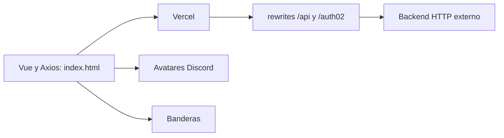

# Web vigente recibida el 2026-11-01

> **Auditoría actualizada:** apareció la implementación auténtica en `7583P/pjsk-bot-discord`, revisión `8a4f812`, recuperada en `.local/season5-current/`. Se verificaron 49 pruebas modernas y 11 del frontend. Falta verificar la base/despliegue definitivos. Consulta [REPORT.md](REPORT.md) para cambios, resultados y límites actuales. Los hallazgos siguientes registran el estado recibido; XSS, carreras, IDs y el contador ya tienen correcciones locales probadas.

Fuente: https://github.com/7583P/pjsk-page.git, checkout separado `web/`, revisión `bc3c069`. La fecha de commit no demuestra por sí sola la fecha de cada funcionalidad. El contenido recibido prevalece sobre las inferencias iniciales basadas únicamente en el bot local de 2025.

## Funcionalidades verificadas por inspección

- Home, conexión Discord, logout y adaptación de zoom móvil.
- Leaderboard con rangos Placement, Iron/Iron ↑, Bronze/Bronze ↑, Silver/Silver ↑, Gold/Gold ↑, Platinum/Platinum ↑, Diamond/Diamond ↑, Crystal/Crystal ↑, Master/Master ↑, Champion, Grand Champion, Star, Divine Star y Legend.
- Umbrales visuales cada 50 MMR hasta Legend >=1000; posiciones agrupadas para Placement/Season Placement y desempate por momento de alcanzar MMR. Esto caracteriza presentación; no permite deducir la fórmula de ganancias/pérdidas del bot.
- Hall of Fame, cutoffs, lista de partidas, perfiles públicos, historial por temporadas y selección de títulos ganados.
- Edit Profile mediante /auth02: identidad Discord, vinculación de jugador y avatar público. La versión recibida usa avatares Discord; no se encontró una galería dinámica de cartas. No se debe reintroducir una galería histórica sin verificar otra fuente vigente.
- Contadores con fechas programadas de fin de Season 4 e inicio de Season 5. Una fecha en JavaScript no constituye activación ni reset efectivo de la base.

## Arquitectura y contratos existentes

vercel.json apunta actualmente por HTTP a un host/IP externo. README_DEPLOY_md aún describe Railway, por lo que la documentación de despliegue quedó desactualizada. backend_fastapi_cookie_patch.py es una referencia de cookies, no la implementación del backend.

| Ruta | Contrato observado en el cliente |
|---|---|
| GET /api/seasons | Array; IDs preservados, nombre y señales de temporada activa |
| GET /api/players?season_id=... | Array completo usado para ranking, historial y cutoffs; ID, MMR, rango, estadísticas, fechas de desempate y títulos |
| GET /api/matches?season_id=...&user_id=...&limit=... | Partidas con entries, scores, deltas, canciones y temporada |
| GET /api/hall-of-fame?include_current=false | Archivo de temporadas completadas |
| GET /auth02 | Inicio OAuth Discord |
| GET /auth02/me | Identidad y jugador verificados por servidor |
| POST /auth02/logout | Revocación de sesión |
| GET /auth02/pfps | Mapa público por ID y nombre |
| GET /auth02/link-candidates | Candidatos y política de verificación |
| POST /auth02/link-player | Vinculación autorizada; no puede confiar solo en userId |
| GET /auth02/titles; POST /auth02/title | Títulos disponibles y selección autorizada |
| POST /auth02/set-pfp | Guardar/eliminar avatar del propio jugador |

## Implicaciones para la reconstrucción anterior

La API FastAPI preparada en la raíz todavía cubre solo la versión antigua. Sus parámetros, esquema y rangos no satisfacen estos contratos. Las pruebas de equivalencia del bot local prueban exclusivamente la implementación 090e97f, no el bot competitivo moderno. Los 58 jugadores SQLite son una fuente histórica local; no se han identificado como la población productiva actual.

No se debe promover la API antigua, ejecutar el reset sobre datos definitivos ni reemplazar los rewrites productivos hasta obtener el bot/backend actual, su esquema y un backup restaurado. Hace falta migrar las vinculaciones, títulos, avatares, estadísticas y archivos reales; no deducirlos de HTML ni inventarlos. Los cambios de infraestructura existentes quedan como trabajo local pendiente de reconciliación.

## Hallazgos de frontend

1. XSS verificable por inspección: showUserProfile interpolaba name y rank con innerHTML. Un nombre se debe renderizar como texto.
2. Carrera al cambiar temporada: fetchPlayers aplicaba cualquier respuesta sin comprobar que correspondiera a la selección actual. fetchMatches presenta el mismo problema.
3. selectSeason convertía IDs a Number aunque el resto del cliente permite IDs arbitrarios.
4. La UI afirmaba que Season 5 había comenzado al vencer un contador, sin comprobar activación en el servidor.
5. Auth02 acepta compatibilidad cookie/Bearer y guarda tokens en localStorage. La migración segura requiere conocer el servidor; no retirar unilateralmente sesiones existentes ni afirmar que las comprobaciones de identidad del frontend protegen el backend.
6. Versiones CDN Vue/Axios sin fijar; no se ha verificado aún su despliegue real. El diseño y los estilos se conservarán.

Estado de lanzamiento: **NOT READY**. El código moderno ya fue recuperado; falta acceso autorizado y verificación de datos/servicios definitivos. Esta auditoría no equivale a una conexión productiva verificada.
